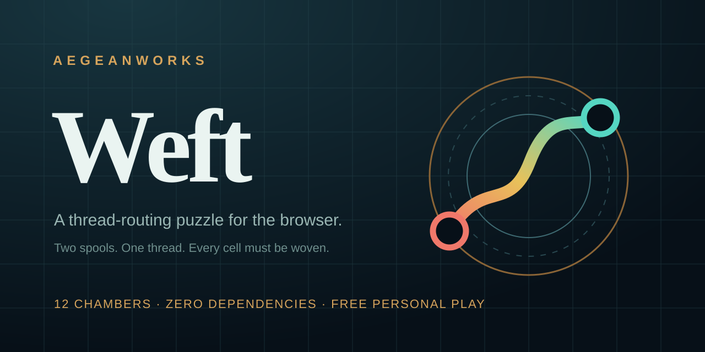

# Weft

<!-- aegean:media:start -->
<p align="center"></p>
<p align="center"><a href="LICENSE"></a> <a href="https://github.com/AegeanWorks/AIKit"></a></p>
<!-- aegean:media:end -->

A zero-dependency thread-routing puzzle: draw glowing threads between matching spools, fill every cell of the loom, and restore the tapestry across eighteen chambers. The whole game is static HTML, CSS and ES modules, so it runs from any static host — including the AegeanWorks Play page.

## ⚡ 30-Second Cold-Start Quick Reference

- **Runtime Prerequisites**: Node.js 20+ (tested on Node 26.9.0) for the local server, tests and level generator; a modern browser with ES modules, pointer events, `<dialog>` and `localStorage` for play. No `npm install`, no network access and no runtime dependencies.
- **Play locally**:
  ```bash
  npm start          # serves http://127.0.0.1:4175/ and opens a browser
  ```
  On Windows you can double-click `play.cmd`; on macOS/Linux run `./play.sh`. Use the printed address so saved progress stays available.
- **Do not open `index.html` directly.** Browsers block ES modules from `file://`; use a launcher or any static server.
- **Canonical Regression Shield Gate**:
  ```bash
  npm test
  ```
- **UI inventory proof**:
  ```bash
  npm run ui:snapshot
  ```
- **Real browser dogfood** (starts the server, solves the first chamber and checks the victory dialog; skips when Edge/Chrome is absent):
  ```bash
  npm run dogfood
  ```
- **Regenerate the eighteen chambers** (deterministic; rerun the tests after):
  ```bash
  npm run levels:generate
  ```

### Controls

| Input | Action |
|---|---|
| Drag from a spool | Draw its thread; the thread closes when it reaches the twin spool |
| Arrow keys | Move focus across the loom |
| Enter / Space | Start a thread from the focused spool |
| Escape | Cancel the current draft |
| Undo / Reset / Hint | Restore the last thread, clear the loom, or show one stored route |
| Sound | Toggle the generated effects from the title or game screen |

## What Is Weft

Every chamber is a square loom with coloured spool pairs. Draw one orthogonal thread between each pair. Threads may not cross, may not share a cell and may not pass through another colour's spool. The chamber is woven only when every pair is connected **and every cell is covered** — so the last thread usually has to take the long way home.

The campaign grows from a 5×5 loom with three threads to a 9×9 loom with nine; Act II takes it to 10×10–12×12 with eight or nine. Each chamber has a stored solution used by the hint ghost and checked by the test suite. Progress, best times, hint counts and sound preference are saved under `weft.progress.v1`; a missing or corrupt record resets safely.

| # | Chamber | Loom | Threads |
|---|---|---|---|
| 01 | First Thread | 5×5 | 3 |
| 02 | Crossweave | 5×5 | 4 |
| 03 | Loom Light | 6×6 | 4 |
| 04 | Tidal Knot | 6×6 | 5 |
| 05 | Bronze Loom | 7×7 | 5 |
| 06 | Salt Weave | 7×7 | 6 |
| 07 | Aegean Fold | 7×7 | 7 |
| 08 | Warp Song | 8×8 | 6 |
| 09 | Shuttle | 8×8 | 7 |
| 10 | Tapestry | 8×8 | 8 |
| 11 | The Long Weave | 9×9 | 8 |
| 12 | Meridian Weave | 9×9 | 9 |
| 13 | Reef Weft | 10×10 | 8 |
| 14 | Lantern Weave | 10×10 | 9 |
| 15 | Deep Current | 11×11 | 8 |
| 16 | Star Loom | 11×11 | 9 |
| 17 | The Far Weave | 12×12 | 8 |
| 18 | Aegean Crown | 12×12 | 9 |

Chambers unlock in order. A finished chamber records its best time; the next one opens automatically.

## What's Inside

```text
weft/
├── .aikit/                    <- project memory: record, ledger, decisions, UI contract
├── .gitattributes             <- CRLF for .cmd and LF for .sh
├── .gitignore                 <- transient state and caches excluded
├── ASSETS.md                  <- asset manifest: what the license covers
├── COMMERCIAL.md              <- commercial licensing terms
├── LICENSE                    <- Aegean Game License 1.1 (AGL-1.1)
├── LICENSES/                  <- REUSE license texts
├── README.md                  <- this living quick reference
├── REUSE.toml                 <- machine-readable SPDX metadata
├── index.html                 <- semantic shell: title, chambers, loom, dialogs
├── package.json               <- zero dependencies; start, test and inventory commands
├── play.cmd                   <- Windows one-click launcher
├── play.sh                    <- macOS/Linux one-click launcher
├── assets/
│   ├── favicon.svg            <- tab mark
│   ├── logo.svg               <- square brand mark
│   └── social-preview.svg     <- 1280×640 social card
├── scripts/
│   ├── dogfood.mjs            <- real browser solve over the DevTools protocol
│   ├── generate-levels.mjs    <- deterministic Hamiltonian chamber generator
│   ├── serve.mjs              <- static server, public-file allowlist, --open
│   └── ui-inventory.mjs       <- stable data-ui / data-panel / data-cue inventory
├── src/
│   ├── game/
│   │   ├── engine.js          <- pure path rules, overlap checks, win detection
│   │   └── levels.js          <- eighteen frozen chambers and stored solutions
│   ├── ui/
│   │   ├── app.js             <- screens, SVG loom, pointer and keyboard input
│   │   ├── audio.js           <- generated WebAudio cues, no audio files
│   │   └── progress.js        <- versioned saves, best times, unlocks
│   ├── styles.css             <- layout and motion using theme tokens
│   └── theme.css              <- the only file with raw colour and font values
└── tests/
    ├── engine.test.js         <- adjacency, crossings, coverage, immutability
    ├── levels.test.js         <- all eighteen chambers solve and stay total
    ├── progress.test.js       <- corrupt saves, best times, sequential unlocks
    ├── server.test.js         <- path containment, MIME, 404s and traversal
    └── ui.test.js             <- screens, controls, tokens, imports, inventory
```

## Design Decisions

- **Pure engine first.** `src/game/engine.js` has no DOM, clock, random source or storage. The browser, the tests and the level validator share one set of rules.
- **Generated, frozen chambers.** Each level starts as a randomized Hamiltonian path, then is cut into threads. That construction makes every stored solution total by definition; `tests/levels.test.js` proves it again on every run. Act II cuts its paths evenly, so no single thread swallows a third of the loom.
- **Static by construction.** There is no API, no build step and no external asset. `index.html`, `src/` and `assets/` are the complete deployment payload, which is why the AegeanWorks Play sync can copy the game by commit.
- **Pointer and keyboard parity.** The loom is a group of real buttons. Pointer drags and arrow-key drafts use the same `beginDraft` / `extendDraft` / `commitDraft` path, and every commit goes through the pure engine.
- **Token-only styling.** Raw colours and fonts live in `src/theme.css`; `src/styles.css` reads custom properties. The test suite rejects raw colour literals in the layout sheet.
- **Small, versioned state.** Progress is a single localStorage record with a version. Unknown fields are ignored, corrupt JSON returns a fresh profile and a faster run replaces the stored best.
- **Generated sound.** WebAudio cues are synthesized after the first gesture; there are no audio files and no autoplay violation.

## AIKit Workflow

Run these from the AIKit checkout:

| Role | Command |
|---|---|
| Project status, task and gates | `python aikit.py status weft` |
| Phase 4: every gate | `python aikit.py check weft` |
| Repair memory and map, then check | `python aikit.py fix weft` |
| Resume an interrupted task | `python aikit.py resume weft` |
| Open a bounded UI task | `python aikit.py ui begin weft --surface web` |
| Verify scope, fast proof, inventory and style drift | `python aikit.py ui verify weft` |

The committed UI contract `.aikit/ui.json` bounds the surface to `index.html` and `src/**`, runs `npm test` as the fast proof, and compares `npm run ui:snapshot` against the baseline. Tests, tooling, project memory and README are protected paths.

## Screenshot QA

The app accepts development-only query parameters so every state can be captured without a driver:

| URL | State |
|---|---|
| `/?screen=title` | Title |
| `/?screen=levels` | Chamber index |
| `/?level=first-thread` | Empty 5×5 loom |
| `/?level=first-thread&preview=hint` | Ghost route |
| `/?level=first-thread&preview=solved` | Completed loom |
| `/?level=first-thread&preview=win` | Victory dialog |
| `/?preview=help` | How-to-play dialog |

The game is also covered by a real browser smoke pass during development: the title, chamber index, help dialog, empty loom, a full three-thread solve, the victory dialog and the 12×12 finale are exercised over the DevTools protocol, with the saved record checked afterwards.

## Verification

- `npm test` runs 54 unit and integration tests with no browser and no network beyond loopback.
- `npm run dogfood` starts the real server, launches Edge/Chrome headless, solves the first chamber, checks the victory dialog and save, and renders the 12×12 finale.
- `python aikit.py check weft` runs the test, mechanics, hygiene, guidelines and secret gates.
- The test suite checks every stored solution, every cell total, path immutability, crossing refusal, corrupt saves, sequential unlocks, MIME types, path traversal and the UI inventory.

<!-- aegean:brand-assets:start -->
## 🎨 Brand Assets

> **AI-Generated Brand Artwork.** The banner and logo are **AI-generated brand assets**. They are illustrative and may not literally depict every feature or the full project scope.
<!-- aegean:brand-assets:end -->

Brand imagery is all rights reserved and is not covered by AGL-1.1; see [ASSETS.md](ASSETS.md).

## 📜 License

Free for personal play under the Aegean Game License 1.1 (AGL-1.1); see [LICENSE](LICENSE). It is DRM-free: Licensor ships no DRM and a distributor may not add it. Streaming, modding and free mods are allowed. Commercial use, paid mods and AI training need the Aegean Commercial License 1.0 (ACL-1.0); see [COMMERCIAL.md](COMMERCIAL.md).
